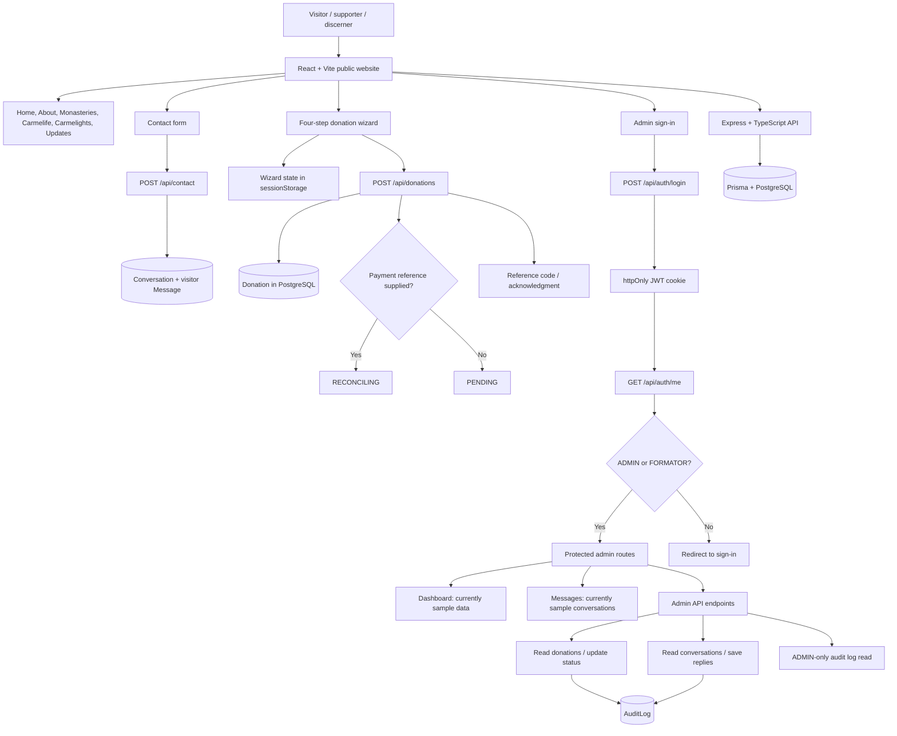
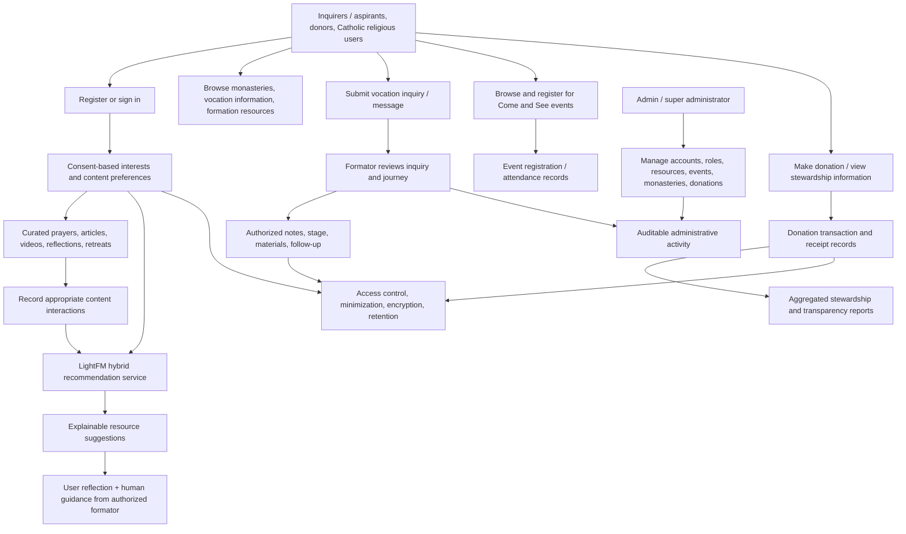

# VocareLink / Carmels in Communion: System Flow and Claude Brief

## How to use this brief

Open the project repository in Claude, attach the complete thesis paper (`Thesis paper (2).docx`), and provide Claude with this file. Ask Claude to read the thesis and inspect the existing code before it writes a new implementation prompt. The ready-to-paste request is at the end of this document.

The repository also includes visual references. Open or attach the relevant screenshots in Claude when asking it to assess the current design. `Home Page.png` is referenced by the original prompt pack but is not present in the current workspace; attach it separately if you have it:

- Public pages: [About Us.png](About%20Us.png)
- Admin dashboard: [Admin dashboard.png](Admin%20dashboard.png), [Admin dashboard-1.png](Admin%20dashboard-1.png)
- Donation flow: [donation.png](donation.png), [donation-1.png](donation-1.png), [donation-2.png](donation-2.png), [donation-3.png](donation-3.png), [donation-4.png](donation-4.png), [donation-5.png](donation-5.png)

## System identity

The thesis proposes **VocareLink**, a web-based vocation development and stewardship platform for the Carmelites in Communion. The current repository implements an early website and admin prototype branded **Carmels in Communion**. Treat these as the proposed product and its current codebase, respectively; do not assume every thesis feature is already implemented.

## Current system flow



### Current routes and behavior

| Area | Current behavior |
| --- | --- |
| Public website | `/`, `/about`, `/monasteries`, `/carmelife`, `/carmelights`, `/updates`, `/contact`, `/donations` are React routes. Several pages use hard-coded text, sample cards, and remote placeholder photography. |
| Contact | The form posts a name, email, category, subject, and message to `POST /api/contact`; the API stores a Conversation and its initial visitor Message. |
| Donations | Four steps collect amount/frequency, payment channel, donor details/receipt preference, and payment reference. Draft fields persist in `sessionStorage`. Submission creates a database Donation and a reference code. Payments are manual; a supplied payment reference sets `RECONCILING`, otherwise `PENDING`. Card checkout is not implemented. |
| Authentication | `POST /api/auth/register` creates USER accounts; `POST /api/auth/login` authenticates and sets an httpOnly cookie; `GET /api/auth/me` checks the session; logout clears the cookie. There is no public registration screen in the current client. |
| Admin UI | `/admin` is guarded for ADMIN/FORMATOR roles. Dashboard and inbox currently use client-side sample data. Updates, users, donation logs, content management, and audit views are generic placeholders. |
| Admin API | Authenticated endpoints list donations and conversations, update donation status, save admin replies, and let ADMIN read audit logs. Donation status updates and saved replies write audit records. |
| Data | Prisma/PostgreSQL models cover users, monasteries, donations/files, conversations/messages, updates, page content, FAQs, and audit logs. |

### Current technology and boundaries

- Client: React 19, TypeScript, Vite, React Router, lucide-react, and Recharts.
- Server: Node.js, Express, TypeScript, Prisma, PostgreSQL, Zod, JWT cookies, bcryptjs, Helmet, CORS, and rate limiting.
- API calls use the `/api` prefix; Vite proxies those requests to the Express server.
- The codebase does **not** currently contain a Python backend or a LightFM service.
- The database does **not** currently model discernment journeys/profiles, formation-resource interactions, events/registrations, or stewardship reports.
- Some public content and admin screens are presentational/sample implementations rather than connected CRUD workflows. Inspect the code before describing any screen as database-backed.

## Thesis target flow



The thesis describes registration and role-based access; vocation inquiries and messages; an inquirer profile/journey tracker; curated formation content; preference-based, explainable LightFM recommendations; monastery information; “Come and See” events and registrations; donations and stewardship reports; and administrative/formator workflows. Use the thesis as the source for the exact scope, intended users, evaluation criteria, and terminology.

## Important gap and decision points

1. The current stack is React/TypeScript + Express/TypeScript + Prisma/PostgreSQL, while the thesis describes Python for backend and LightFM. Claude must identify this difference and propose a compatible integration or a clearly scoped migration option; it must not silently replace the stack.
2. The current app supports ADMIN, FORMATOR, and USER roles, but not all thesis actor distinctions as separate implemented experiences. Map thesis roles to existing roles explicitly and flag any role/schema changes.
3. The repository currently supports donations and contact inquiries, but not the thesis journey tracker, resource library/recommendation engine, event registration, or stewardship reporting end to end. Label these as gaps, not existing functionality.
4. Payment submission records a manual transfer; it is not a payment gateway or automatically verified transaction. Do not describe it as secure online checkout unless a provider is actually integrated.
5. Do not invent thesis requirements when the paper is ambiguous or internally inconsistent. List the ambiguity and make a conservative recommendation for the owners to approve.

## Non-negotiable product and privacy constraints

- Recommendations are decision-support for relevant spiritual/formation resources only. They must never score vocation suitability, spiritual readiness, or a person's worth, and must never replace discernment with an authorized human formator.
- Use only consented, appropriate preference, interest, and content-interaction data for recommendation features. Do not put sensitive personal, psychological, or confidential spiritual information into recommendation feature vectors. Treat such information as restricted, minimize collection, encrypt it where stored, and define access/retention safeguards based on the thesis and applicable requirements.
- Make recommendation explanations understandable, and provide a way to decline or change personalization where appropriate.
- Preserve anonymous giving. Never expose donor-level information in public pages or aggregate reports; collect only information required for a requested receipt or operational purpose.
- Enforce role-based access on the server, validate inputs server-side, protect credentials/secrets, and audit sensitive administrative mutations.
- Keep the interface responsive, accessible, calm, low-cognitive-load, and appropriate to Carmelite contemplative life. Do not add flashy gamification or manipulative prompts.

## Ready-to-paste request for Claude

```text
I am attaching our thesis paper and providing a system-flow brief plus access to the existing project repository. Read the entire thesis first, then inspect the codebase. Your task is to create a NEW, high-quality implementation prompt that I can give to Claude Code to polish and align this existing system with the thesis. Do not implement or edit the application in this task.

Use the thesis as the authority for the intended product, scope, users, requirements, ethical constraints, and evaluation criteria. Use the repository as the authority for what is actually implemented today. The supplied flow brief is a guide, not a substitute for checking the source code.

Before writing the new prompt:
1. Summarize the product and its end-to-end user/admin/formator flows in plain language.
2. Compare thesis requirements with existing routes, screens, API endpoints, data models, and working behavior. Separate implemented, partial/demo, and missing features. Do not call sample/static screens database-backed.
3. Identify contradictions or decisions needing approval, especially the thesis's Python/LightFM stack versus the repository's React + Express + Prisma stack. Recommend the smallest compatible architecture and explain when a separate Python recommendation service is warranted. Do not silently replatform.
4. Extract the thesis's functional and non-functional requirements, intended roles, privacy/ethical requirements, and evaluation criteria. Cite thesis section/page when available and cite repository paths for code observations.
5. Review the linked PNG screenshots as design references. Distinguish screenshot intent from current implementation, note any design requirements that conflict with accessibility or the thesis, and do not treat a screenshot as evidence that its workflow is implemented.

Then produce a ready-to-use, repository-specific implementation prompt for Claude Code. It should:
- State the system purpose, users, current architecture, and verified current baseline.
- Organize polishing into small prioritized phases with explicit scope, dependencies, and acceptance criteria. Prioritize completing and connecting existing user flows before adding thesis features; do not fabricate content or pretend payment processing exists.
- Specify role-based workflows for visitors/supporters, inquirers, formators, administrators, and super administrators, while identifying any role mapping/schema changes for approval.
- Cover the thesis features that are in scope: guided discernment/journey tracking, curated formation resources, consent-based and explainable LightFM recommendations, monastery information, Come and See events/registration, donations, and aggregated stewardship/transparency reporting. For each, distinguish new work from existing behavior.
- Enforce these safety rules: recommendation is only decision-support for resources, never vocational suitability/readiness scoring; exclude sensitive psychological and confidential spiritual data from recommendation features; keep discernment human-guided; preserve anonymous giving; protect donor and inquirer data; use least privilege, server validation, and audit trails.
- Preserve the existing design direction and responsive/accessibility requirements found in the code and thesis. Avoid unnecessary rewrites, dependencies, schema churn, and unrelated cleanup.
- Require tests and validation for each phase, database migration/seed updates where needed, documentation updates, and a final report mapping thesis requirements to implementation and remaining gaps.
- Tell Claude Code to inspect the relevant files before each change, make minimal cohesive edits, run the narrowest relevant tests/build after each phase, and report blockers rather than inventing behavior.

Output your analysis briefly, followed by the final implementation prompt in one copyable Markdown code block. Include open questions separately and do not bury unresolved thesis conflicts inside assumed requirements.
```

## Repository files to inspect first

- `README.md` for setup and the current feature summary.
- `client/src/CarmelApp.tsx` for public routes, donation/contact flows, login, and admin UI behavior.
- `client/src/Carmel.css` and `client/src/index.css` for the current visual system.
- `server/src/index.ts` for API behavior, validation, authentication, and authorization.
- `server/prisma/schema.prisma` and `server/prisma/seed.ts` for persisted entities and seed assumptions.
- `carmel-copilot-prompt.md` for the original design/feature brief; treat it as an earlier aspirational prompt, not proof of current implementation.